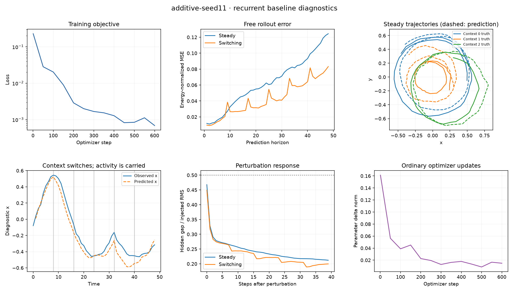

# Initial substrate benchmark — October 25, 2026

**All 12 model/seed runs pass the predefined substrate readiness screen.** This
supports investigating online writes on this synthetic substrate. It does not
establish self-organization, learned functional scope, composition, or the full H1
claim of reusable dynamical structure. Those mechanisms remain unimplemented.

The simplest shared additive model is a reasonable reference for the next work
package. This experiment does not establish a reliable advantage for extra gating
or low-rank modulation. Keep all four baselines available.

## Setup and traceability

- Source commit: `e861742bd3c2393d7870461771e55bb5f9cd3199` (clean working tree).
- Source SHA-256: `2764fbb82a0b3e3c1d4cbcf650b1fae8a2c91b17f76f870002fe9dcc28b5d259`.
- Python 3.12.13, Torch 2.14.1, NumPy 2.5.4; macOS ARM64; float32 CPU,
  one Torch thread, deterministic algorithms. Dependencies pinned in `uv.lock`.
- Seeds 11, 23, 47; three known contexts; frozen rank-2 projection into 12 features.
- Each model sees 28,800 training sequences / 691,200 real synthetic transitions:
  600 steps × batch 48 × horizon 24. Both free and grounded objectives use those
  same transitions. No test-based checkpoint selection or tuning occurred.
- Test: 96 sequences per condition at horizon 48; separate 192-step switching
  stability evaluation. Training and test RNG streams are distinct.
- Predefined thresholds: [protocol](../docs/EXPERIMENTS.md). Exact per-seed decisions:
  [readiness.json](substrate/readiness.json).

The separate-core baseline shares sensory initialization/readout and independently
parameterizes each context's recurrent transition. Its 2,812 parameters are 2.8%
below the additive model's 2,892. It is not a completely independent encoder/RNN/readout
ensemble. Gated and low-rank models have 4.1% and 11.5% more parameters than additive;
this is not an exactly capacity-matched comparison for those variants.

## Prediction results

Mean ± sample standard deviation across three seeds. NMSE is feature MSE divided
by target feature energy; it is not an accuracy percentage or R².

| Model | Parameters | Grounded one-step NMSE | Free 48-step NMSE | Switching 48-step NMSE | Switching 192-step NMSE |
| --- | ---: | ---: | ---: | ---: | ---: |
| Additive | 2,892 | 0.0084 ± 0.0009 | 0.0678 ± 0.0062 | 0.0630 ± 0.0231 | 0.1537 ± 0.0457 |
| Gated | 3,012 | 0.0083 ± 0.0010 | 0.0670 ± 0.0078 | 0.0657 ± 0.0202 | 0.1654 ± 0.0373 |
| Low-rank | 3,224 | 0.0091 ± 0.0017 | 0.0654 ± 0.0202 | 0.0596 ± 0.0185 | 0.1596 ± 0.0436 |
| Separate cores | 2,812 | 0.0046 ± 0.0002 | 0.0950 ± 0.0192 | 0.0703 ± 0.0019 | 0.2472 ± 0.0735 |

The zero-fit persistence reference has mean steady free NMSE 1.9833 and grounded
one-step NMSE 0.0282. Every learned model beats it. The worst per-context steady
NMSE among all runs is 0.2025 (separate cores), below the predefined 0.25 threshold.

Grounded one-step accuracy is better for separate cores, while their free multistep
error is larger on average. One-step accuracy alone is therefore an inadequate
selection criterion. With three seeds and a single task family these differences
are descriptive, not evidence of statistical significance or general superiority.

## Switching, perturbations, and failure analysis

Context changes never reset recurrent activity. Switching-error traces, per-context
errors, and prefix-wise errors are saved in the [raw results](substrate/results.json).
All 192-step unperturbed trajectories are finite and below the |h| > 1.5 bound.
The largest observed hidden magnitude is 0.9979. This bound is largely guaranteed
by leaky tanh; it is not evidence for useful attractors.

Gaussian hidden perturbations (standard deviation 0.15 per unit) shrink relative to the paired
unperturbed trajectory. Mean final hidden-gap ratios are 0.1875 additive, 0.1916
gated, 0.1666 low-rank, and 0.2046 separate. Approximately 97–99% of steady trials
sustain at least a halving of the injected gap over the final four steps. However,
perturbations still increase grounded-target MSE on average: +0.00096, +0.00100,
+0.00065, and +0.00235 respectively. Contraction toward a model trajectory does not
prove recovery toward the correct physical trajectory or an attractor manifold.

The important limitations and negative findings are:

- **Long-horizon drift remains.** All model means worsen at horizon 192. Qualitative
  plots show phase/radius errors. These initial thresholds screen boundedness, not
  high-fidelity indefinite prediction.
- **Added context machinery has no established advantage here.** Low-rank/gated
  results overlap the additive baseline across this small sample, despite extra
  parameters and time. No model selection sweep was performed.
- **Known context and full observability simplify the problem.** There is no context
  inference, occlusion, ambiguity handling, continual learning, or compositional test.
- **Switch timing is regular and appears in training.** Unexpected schedules and
  withheld action distributions need separate evaluation before stronger H1 claims.
- **Sharing is not demonstrated reuse.** All three contexts were trained. A common
  weight matrix alone says nothing about withheld-composition transfer (H5).

Wrong-context interventions raise steady NMSE to roughly 1.61–1.92; reversed action
sequences raise it to roughly 0.10–0.14. These checks show sensitivity to supplied
controls, not learned causal disentanglement or a substitute for trained ablations.

## Resource measurements

| Model | Weight bytes | Optimizer tensor bytes | Linear MACs per transition | Mean training seconds |
| --- | ---: | ---: | ---: | ---: |
| Additive | 11,568 | 23,168 | 2,200 | 3.47 |
| Gated | 12,048 | 24,132 | 2,200 | 4.18 |
| Low-rank | 12,896 | 25,836 | 2,520 | 4.60 |
| Separate cores | 11,248 | 22,536 | 1,000 | 5.55 |

MACs include linear recurrent/action/readout operations, exclude nonlinearities,
gating, initialization, assimilation, dispatch, and backward computation; one MAC
conventionally counts as two FLOPs. Two rollouts are differentiated per training
batch. Separate-core Python dispatch overhead helps explain its larger wall time
despite fewer counted MACs. Tensor bytes are not peak process memory. These small
CPU timings describe this machine/run and are not performance guarantees.

## Diagnostics and reproducibility

The figure below shows seed 11, the first listed seed; it is not the best-performing
seed selected from a search. Dashed state trajectories are predictions; inverse projection
is confined to diagnostics.

The figures were re-rendered from saved trajectories after correcting clipped labels.
[Figure provenance](substrate/figure-provenance.json) records the renderer and image hashes;
the numerical records remain unchanged.

Additional figures: [gated](substrate/gated-seed11.png),
[low-rank](substrate/low_rank-seed11.png), [separate cores](substrate/separate-seed11.png).

All four models were independently rerun for seed 11 at full training length.
Numerical metrics, checkpoint parameter tensors, and saved trajectory arrays match
exactly; wall times are excluded. See [reproducibility record](substrate/reproducibility.json),
[original provenance](substrate/provenance.json), [repeat provenance](substrate/repeat-provenance.json),
and [resolved configuration](substrate/config.json).

Validation: **15 pytest tests pass**; Ruff checks pass; four-model smoke experiment
passes; diagnostics were visually inspected. Bootstrap had no tests, then an
initial editable-install discovery problem was corrected before validation. Local
Qwen test/audit attempts produced no usable review, so implementation and verification
were completed directly.

Full checkpoints, trajectories, and per-seed logs are preserved locally in
`runs/substrate/` and `runs/substrate-repeat/` (ignored by Git). Compact measured
results, provenance, readiness checks, and representative plots are committed here.

## Next bounded work package

WP-00 and the immediate substrate sprint are implemented; the broader H1 reuse
claim remains open. A reasonable next step is WP-02 on a fixed additive substrate:
designate plastic parameters, freeze ordinary training, compare no adaptation,
Hebbian/delta/RLS writes, and online gradients under matched observation budgets.
Record before/after errors across all contexts and free rollouts. Establish this
local-acquisition result before implementing learned scopes or consolidation.

Do not infer support for SOAM's novel learning mechanism from this baseline benchmark.
