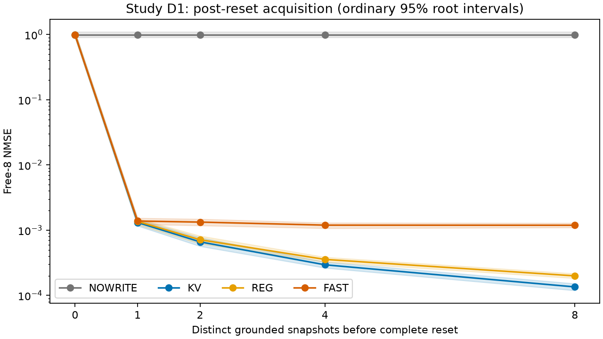
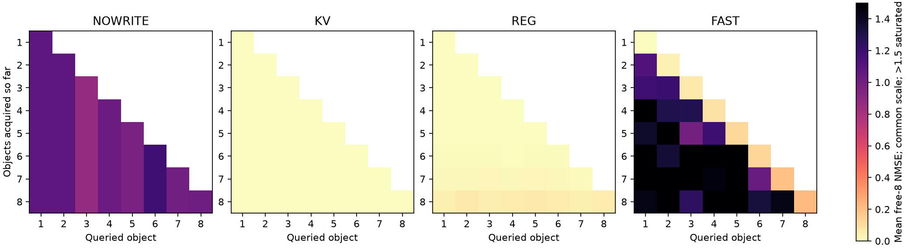

# Study D — explicit memory retains new associations; the tested fast weights interfere

**Explicit key-value memory is sufficient for this bounded post-reset task.** All
three writers learn a single unfamiliar object from a few grounded snapshots, but
only KV passes the joint acquisition and sequential-retention criteria. The tested
FAST rule has a precisely negative practical-advantage result versus both KV and
mask-aware regression, and severe interference. This is evidence about one linear
rank-one write rule under supplied appearance/action structure, not a rejection of
recurrent memory generally. The [decision](STUDY_D_DECISION.md) retains KV as the
reliable reference and activates no subsequent experiment.

November 17, 2026. D0–D2 only. See the [protocol](../docs/STUDY_D_PROTOCOL.md),
[paired tables](study-d/tables.md), [statistics](study-d/statistics.json),
[verification](study-d/verification.json), and [source receipt](study-d/confirmation-receipt.json).

## Frozen outcomes

- KV: persistent-acquisition conjunction supported; one-shot conjunction supported.
- REG: persistent-acquisition conjunction not passed; one-shot conjunction not passed.
- FAST: persistent-acquisition conjunction not passed; one-shot conjunction not passed.
- FAST versus KV: negative practical advantage; relative D1 gain -1.1485 [-1.3242, -0.9649].
- FAST versus REG: negative practical advantage; relative D1 gain -0.9577 [-1.1273, -0.8026].

These are the frozen family-adjusted conclusions; guardrails are reported separately.
A failed conjunction does not mean no information was acquired. Wide intervals do not
establish equivalence. Relative gains use per-root ratios, not a ratio of means.

## Measured acquisition and retention

Primary J (free-8 NMSE averaged over 1/2/4/8 snapshots) is .000601 for KV, .000658
for REG, .001274 for FAST and .988019 for NOWRITE. All writers reach 100% sampled
single-object accuracy at eight snapshots. After sequential acquisition, accuracy
on the first seven objects is 100% for KV, 87.10% for REG and 5.98% for FAST.
Accuracy means canonical NMSE <=.1; it is not an object-ID classification score.
There are 2240 old-object query outcomes nested within ten independent roots.

KV's mean old-object error change is exactly zero on these query sets. REG's
change is +.05111, family-adjusted interval [.03315,.07160]; FAST's is +1.39573
[1.11154,1.76907]. Both lower bounds exceed the frozen .02 retention margin.
Their failures are established interference under this protocol, not merely an
unresolved guard. KV's zero-width accuracy/retention bootstrap intervals reflect
no observed failures and identical outputs in this finite sample; they do not
guarantee all future cues or loads.

FAST's relative primary gain versus KV is -114.85% [-132.42%,-96.49%]; versus REG
it is -95.77% [-112.73%,-80.26%]. Both adjusted intervals meet the frozen width
limit and exclude the required +10% benefit. Negative gain means greater error.
These are per-root relative differences. The error floor is not triggered.
Its absolute mean excess J is .000673 versus KV and .000616 versus REG; the
small absolute single-object errors should be read alongside the much larger
sequential failures. No thresholds or settings changed after confirmation.

The formal one-shot conjunction also includes retention, so it passes only for
KV. This does not deny REG/FAST's measured one-snapshot learning. Offline motion
probes remain essentially exact and core tensors unchanged: the old-object failure
is in association retrieval, not destruction of the shared rotation model.

## Failures and mechanism limits

The prespecified first confirmation root 32003, sequence 0, object 0 illustrates
the change (averaged over its eight held-out queries):

| Model | Immediately after acquisition | After seven further objects |
| --- | ---: | ---: |
| KV | .0000897 | .0000897 |
| REG | .0001095 | .100984 |
| FAST | .0006089 | .599687 |

[Failure identities](study-d/representative-failures.json) also retain worst cases
without excluding them: FAST reaches free-8 NMSE 13.926 on root 32057, sequence 3,
object 4, query 3 (zero-based indices). The retention plot saturates above 1.5, as
labelled; raw values remain in the archives.

For the unclipped delta proposal, a new key changes an old key's output in
proportion to their dot product. Similar appearances therefore couple otherwise
independent relationships. That is an algebraic explanation for a vulnerability,
not an executed causal key-correlation ablation. REG's remaining failure may also
involve ill-conditioned completion from partial keys; this study does not isolate
those sources. A direct matrix-map control and normalized online-gradient control
are algebraically identical to this FAST update/readout, verified in tests. Its
name is not evidence for a distinct neural mechanism.

Unknown same-family cues are accepted on 0% of sampled queries by KV, 32.1% by REG
and 90.5% by FAST. Thresholds were calibrated on separate known-object development
queries only. These are descriptive false-familiarity results, not corruption
resistance or calibrated confidence. No learned reliability policy was tested.

Across all eight known objects at the final stage, accepted-but-wrong recall occurs
on 0% of queries for KV, 10.43% for REG and 82.77% for FAST (ordinary root intervals
[0,0], [8.20%,12.58%], [80.31%,84.92%]). Known-query acceptance is 94.30%, 91.37%,
and 94.38%, respectively. Thus the raw accuracy endpoint and a decision to accept
a recall are distinct; KV's 100% sampled raw accuracy is not 100% acceptance.

## Resource interpretation

[The Pareto table](study-d/tables.md) reports actual allocated storage and measured
read/write times. KV retains 7448 numerical bytes including the shared core and
settings, versus 4120 for REG and FAST. KV preallocates 32 rows while D2 uses eight;
we do not claim an unmeasured compact allocation or exact matching. FAST/REG match
each other in numerical persistent bytes. Mean serial recall is 33.12 microseconds
for KV, 34.69 for FAST and 58.82 for REG; mean writes are 40.22, 37.44 and 29.44
microseconds respectively. These are implementation-specific descriptive timings.
KV is the only tested mechanism meeting the full reliability criteria, not a
proven globally cheapest architecture or a winner on every resource dimension.

All models retain 24 float64 transient values per query (192 bytes). Scientific
batches of eight therefore hold 1536 state bytes and return 4608 prediction bytes
for nine states; input arrays and operation workspaces are additional. The stored
`active_state_batch_bytes` describes the final serial profiling call, not peak
scientific batch state. An undo snapshot duplicates each model's writable bytes.
Evaluator trajectory archives are separately charged as artifacts, not learner memory.

Analytic operation estimates: every common action step uses 128 linear MACs plus
trigonometric/scalar operations. FAST recall uses 384 MACs plus normalization/scoring;
REG uses 192 MACs plus an 8x8 solve and scoring. KV compares eight occupied rows
across sixteen coordinates (including masked arithmetic), then selects a nearest
row. FAST writes add a 384-MAC read, 384 outer-product multiplications, norm/clipping
and the common 128-MAC canonicalization; REG accumulates 384 outer-product products
plus canonicalization. KV's exact-key comparisons and eight-value running mean are
additional. Each core fit forms 786432 normal-equation MACs plus a 16x16 solve with
eight RHS columns. These partial arithmetic estimates exclude allocation/dispatch
and are not replacements for timings or process RSS.

## Scope and costs

All candidates receive identical grounded snapshots and queries. Each offline core fit
uses 2048 clean transition pairs (4096 feature snapshots). Each model/root evaluation
uses 448 new acquisition snapshots, once each, and 2368 read-only queries. Repeated
evaluation of old objects supplies no training evidence. There is no replay or online
slow-core fitting. Calibration uses distinct development objects; confirmation is fresh.

Appearance is a stable observed random feature vector. The relationship is independently
random. Half the appearance coordinates are hidden at query, and no relationship is
shown. The task supplies a reversible rotation family, action basis, full acquisition
snapshots and a proprioceptive angle reference. It tests memory plus reuse of that
fitted transformation, not learned correspondence, unknown geometry or organization.

FAST is one delta-updated block of an explicitly structured recurrent state operator.
Its one-step retrieval is exactly a direct linear associative map. The same-byte REG
control uses mask-aware sufficient statistics; KV uses larger preallocated episodic
storage. These comparisons cannot establish a special advantage of recurrence, shared
neurons, attractors or general fast-weight mechanisms. Independent whole-model refitting
and learned write selection were not tested. D3/D4 remain deferred.

Familiarity scores are development-thresholded reconstruction distances, not calibrated
probabilities. Reported accepted wrong recalls and unknown acceptance are diagnostics;
they do not establish robust writing under corrupt evidence or changing objects.

## Reproduction and source

Frozen source aggregate: `e3b352a3cc4257203baced7a5be720b0884309efa9f31680cd5b50b0146241d2`; base commit
`227074388fc1f48da3ca9c340d5fd503e285658b`. Exact source copies, fit inputs, all predictions/errors,
checkpoints, roots and status records are under `runs/study-d-v1/`. Python/Torch/NumPy,
platform, dirty status and settings are in the receipt. CPU only, one Torch thread,
float64, deterministic algorithms. The first full root is repeated exactly; unchanged
historical Study C files are checked. No historical gate is reinterpreted.

Commands: `UV_CACHE_DIR=/private/tmp/soam-uv-cache MPLCONFIGDIR=/private/tmp/soam-mpl uv run python -m soam.acquisition.runner PHASE`, with fixture, development, freeze, confirmation, repeat, report in that order. Existing phase directories refuse overwrite; use an isolated
checkout from the frozen snapshot for reproduction. Resource ledger includes numerical
fixture, selection, calibration, confirmation, repeat, profiling and reporting. Tests,
imports/process startup, source review and language-model work are separate engineering
overhead; no GPU work occurred.

## Completion and next decision

All 16 declared offline fits and 88 model evaluations completed; no failed fits,
excluded roots, replacement seeds or budget extensions. Root 32003 repeats all
64 saved numerical arrays exactly, together with input hashes, terminal memory
fingerprints and the fitted core. Independent reconstruction of 280 endpoint values
agrees within 2.22e-16. The final [archive audit](study-d/archive-verification.json)
checks 40 input/checkpoint records, 102 frozen source files and 1135 indexed raw
artifacts; all 95 historical C source hashes remain unchanged. Plots were visually
inspected. Before numerical work, 303 tests, Ruff and ticket validation passed.

[Final resources](study-d/resource-final.json): 51.13 numerical CPU seconds, 61.60
execution-wall seconds, 344047616 bytes peak RSS and about 165 MB of artifacts,
within 7200/14400 seconds and 2 GiB ceilings. The font-cache setup is included in
report wall time. The separate audit script is fingerprinted; it adds no scientific
fits, streams, threshold changes or selected mechanism. Qwen did not return during
preflight; primary-agent review/execution was used.

This informative negative result merits a joint report/blog: fast acquisition of
an isolated association and preservation across similar objects are different
capabilities. The owner was notified; no publication is authorized here. The sole
recommended follow-up is a fresh-stream full-versus-partial-cue D2 diagnostic with
unchanged writers, to distinguish incomplete-cue inference from stored-association
interference. It is not selected or executed. D3/D4 and all other forks stay deferred.
