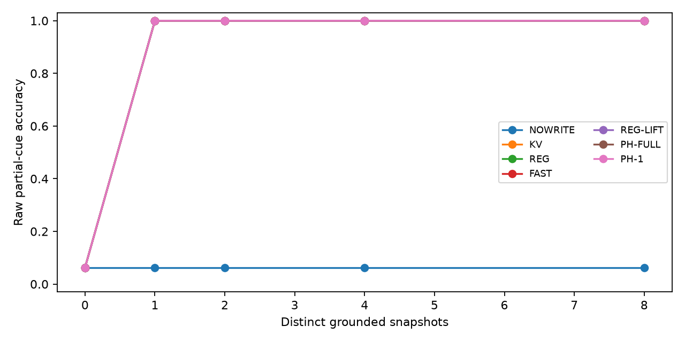
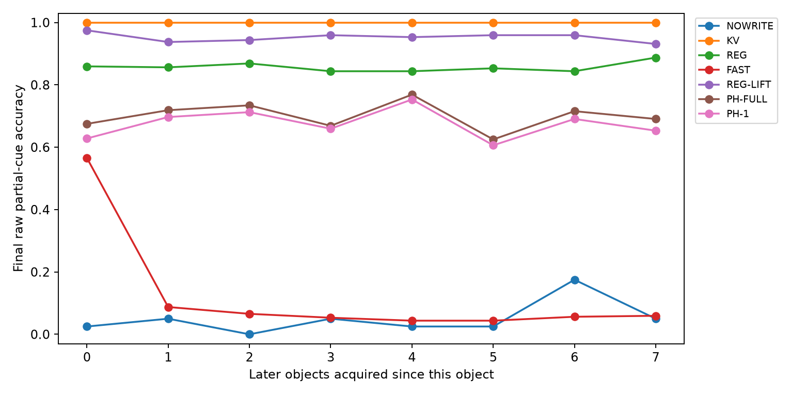
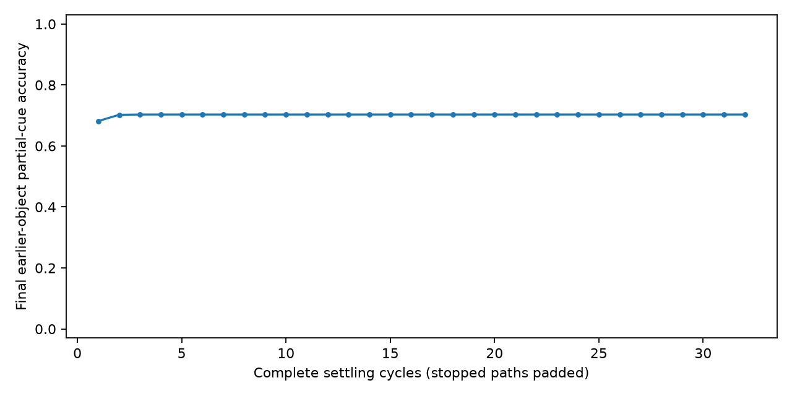
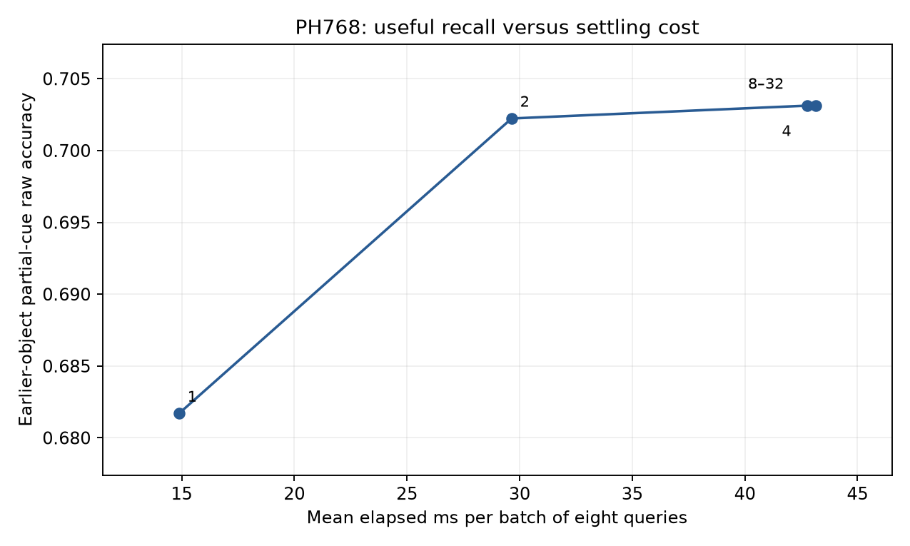

# Study D-R1 — recurrent associative retrieval

The frozen [protocol](../docs/STUDY_D_R1_PROTOCOL.md) tests PH768 projection memory,
with same-weights PH-1, NOWRITE, KV, REG, FAST and REG-LIFT controls.

**PH768 learned isolated associations, but failed reliable sequential retrieval.**
Additional settling improved final earlier-object partial-cue accuracy by **2.14
percentage points**, with an adjusted interval of **0.98–3.66 points**. This is a
small positive effect, but an **adequately precise negative practical-benefit
result** against the frozen five-point margin. The separate reliable-retrieval
conjunction failed on earlier-object accuracy, retention error and accepted wrong
recall. These are measured failures of this candidate, task and allocation, not a
general rejection of recurrent associative memory.

The [scoped decision](STUDY_D_R1_DECISION.md) accepts this evidence and retains KV
as the conventional reference. No subsequent experiment is activated.

## Frozen experiment

The fixed candidate has 768 threshold-coded units: 512 for appearance and 256 for
relationship features. Each grounded snapshot incrementally extends an orthogonal
projector P; retrieval uses symmetric zero-diagonal weights W = P − diag(P).
Observed appearance bits stay clamped while free units undergo deterministic
asynchronous sign updates. PH-1 returns after one complete cycle; PH-FULL uses the
same weights and first cycle, stopping at no change or 32 cycles. A fixed decoder
and shared fitted action core then produce free eight-step predictions. No pattern
bank, replay, target-informed iterate selection or persistent inference writes are used.

Every root fits the supplied action basis from 2,048 clean transitions (4,096
feature snapshots). Each arm then receives 448 distinct grounded acquisition
snapshots: 24 isolated objects × eight snapshots and four eight-object sequences ×
eight snapshots. Memories reset between isolated objects and sequences; transient
state resets before each query. Full and eight-of-16 partial appearance cues share
the same visible noise. Appearance/relationship correspondence, encoding, clamps,
roles and trigonometric action basis are supplied. The initial sensory projection
is fixed. Data exposure, every stored/active state and the fitted core are charged.

The namespace is `soam-study-d-r1-v1`. Fixture root: 40011; development/calibration:
41001 and 41013 with separate streams; confirmation: 42003, 42009, 42027, 42029,
42051, 42057, 42059, 42063, 42069 and 42077; exact repeat: 42003. Both development
roots passed the prespecified isolated-object competence screen. Development chose
core ridge 1e-6, REG/REG-LIFT ridge .01 and FAST rate 1.0; PH768 had no architecture
or setting search. Independent calibration and all selections were frozen before
confirmation generation; see the [freeze receipt](study-d-r1/freeze-receipt.json).

## Confirmatory results

Ten independent roots; paired root-bootstrap intervals use the frozen
12-quantity Bonferroni family. Nested queries are not independent roots.

| Contrast | Mean | Adjusted interval | Outcome |
| --- | ---: | --- | --- |
| PH-FULL minus PH-1 | 0.02143 | [0.00982, 0.03661] | adequately precise negative practical benefit |
| PH-FULL minus REG | -0.15357 | [-0.21250, -0.06786] | inconclusive |
| PH-FULL minus KV | -0.29688 | [-0.36116, -0.21518] | inconclusive |
| PH-FULL minus REG-LIFT | -0.24598 | [-0.30670, -0.17321] | inconclusive |

The primary interval width is .02679, below the frozen .10 cap. All three secondary
intervals favor the conventional comparators in direction, but their widths
(.14464 REG, .14598 KV, .13348 REG-LIFT) exceed .10. Their **preregistered categorical
outcome remains inconclusive** under that precision rule; this is not evidence of
equivalence or a PH768 advantage. No extra roots were added.

The remaining acquisition contrast, PH-FULL's relative reduction of isolated-object
free-eight error J over NOWRITE, is .99792 [.99757, .99830]. It passes the .20 point,
positive lower bound and .40 width criteria. J averages budgets 1/2/4/8; its mean
is .00210 for PH-FULL and 1.03823 for NOWRITE. All 12 frozen quantities are reported.

| PH768 guard | Mean | Adjusted interval | Pass |
| --- | ---: | --- | --- |
| accuracy8 | 1.00000 | [1.00000, 1.00000] | True |
| error8 | 0.00118 | [0.00096, 0.00140] | True |
| old_accuracy | 0.70312 | [0.63884, 0.78482] | False |
| retention | 0.04784 | [0.03522, 0.06340] | False |
| known_coverage | 0.94196 | [0.93036, 0.95491] | True |
| accepted_wrong | 0.27232 | [0.19464, 0.33438] | False |
| unknown_acceptance | 0.00000 | [0.00000, 0.00000] | True |

Accuracy8 and error8 are isolated-object budget-eight canonical accuracy and
free-eight NMSE. The old_accuracy guard requires a lower bound of .80; even its
upper bound is only .78482. Retention is the free-eight NMSE increase between an
object's immediate post-acquisition and final evaluation: its lower bound .03522
exceeds the .02 ceiling. Accepted wrong recall uses **all known queries** as its
denominator; its lower bound .19464 exceeds .05. Each failure is established by
an interval wholly on the adverse side, not merely a failed lower-bound test.
Known coverage requires lower ≥.90; unknown acceptance requires upper ≤.10.

There are ten independent roots, 1,920 isolated budget-eight queries, 2,240 final
earlier-object queries and 2,560 unknown queries per cue view. Nested queries do
not enlarge the independent sample size. The all-success isolated and all-rejected
unknown outcomes have empirical zero-width intervals; they do not imply universal
reliability or zero population risk.

## Conventional controls and cost

| Arm | Partial old accuracy | Full old accuracy | Persistent bytes | Serial recall us |
| --- | ---: | ---: | ---: | ---: |
| NOWRITE | 0.05357 | 0.05357 | 1048 | 30.22 |
| KV | 1.00000 | 1.00000 | 7448 | 47.25 |
| REG | 0.85670 | 1.00000 | 4120 | 72.79 |
| FAST | 0.05848 | 0.04152 | 4120 | 48.49 |
| REG-LIFT | 0.94911 | 0.99687 | 2131480 | 2480.48 |
| PH-FULL | 0.70312 | 0.71607 | 4720160 | 28286.43 |
| PH-1 | 0.68170 | 0.70982 | 4720160 | — |

PH-1 shares the acquired checkpoint; its trace records first-cycle cost.
The shared arm's archived serial profiler invokes full retrieval, so it does not
provide an independent PH-1 serial speed comparison. Use the measured first-cycle
batch cost below. Persistent bytes include the fitted core and supplied numerical
settings; all arms fit within the 8 MiB ceiling but do not use matched resources.
KV is both more accurate and far cheaper than PH768 in these measurements;
REG-LIFT also has higher recall with less storage and lower latency. There is no
preregistered global cheapest-mechanism claim or new adjusted reliability
conjunction for the conventional arms.

For scale, an approximate dense arithmetic estimate for the implemented PH sweep
and per-cycle invariant/score diagnostics is 5 × 768² ≈2.95 million multiply-add
pairs per query per executed batch cycle, plus one initial 768² energy product.
This includes zero-delta updates for clamped/converged rows. A PH write uses two
768² matrix-vector products, a third on a novel-code validation, plus the rank-one
outer product and symmetrization. These are estimates of the verified implementation,
not hardware FLOP measurements or an optimized deployment lower bound. Raw REG
solves an 8/16-coordinate system per partial/full query; REG-LIFT solves 256/512
coordinates, with dense factorization scaling cubically. FAST uses a 24-by-16 map
for relationship output and key reconstruction; KV scans at most eight
16-coordinate keys. Each shared action step
uses two 8-by-8 products. Offline core fitting forms a 16-coordinate ridge system
from 2,048 transitions for every one of the 16 fits; this fitting is included in
total allocation. Measured wall/CPU/RSS and latency remain the practical cost evidence.

All writable arms reach 100% sampled isolated canonical accuracy after one snapshot;
their curves overlap. This easy isolated task does not establish retention.

Each position is evaluated at the end of an eight-object sequence. Position zero
means the last acquired object, with seven other objects already stored; it is not
an isolated-object result. The primary earlier-object endpoint averages positions
one through seven. Curves are descriptive root means.

Full calibrated root metrics, acceptance denominators and descriptive uncertainty
are in [root results](study-d-r1/root-results.json) and [statistics](study-d-r1/statistics.json).
Zero-width boundary intervals describe this finite sample, not zero population risk.

Verification: 5497 numerical arrays repeat exactly; 2100 endpoints independently reconstructed.

Source commit: `a84736dbbd3fcdf51bd59b868e2ac5557b17d451`; fingerprint `347e5eb9cb539374ea069de2d485f33fdb2070b06a9fbb2c670f207ffe034011`.
All 102 historical D source hashes remain unchanged.
Fresh allocation: 7200 CPU / 14400 execution wall seconds, 2 GiB RSS/artifacts.
Numerical fixtures, failures, development, calibration, confirmation, repeat and
reporting are charged cumulatively; process import/startup and engineering are separate.
Through numerical reporting/audit, measured use was **650.685 CPU seconds,
651.444 execution-wall seconds, 428,195,840 bytes peak RSS and 572,202,962 bytes of
artifacts before the final receipt**. The [cumulative ledger](study-d-r1/resource-final.json)
includes all nine phases. All are complete, with no failed attempts, exclusions,
replacement roots or budget extensions. Later documentation/archive packaging is
recorded separately and included in the [final closeout receipt](study-d-r1/closeout.json).
The [final archive index](study-d-r1/archive-final.json) covers the raw and compact
artifacts, with self-referential receipt exclusions stated explicitly.

CPU PyTorch float64, deterministic operations, one intra-op and one inter-op thread;
Python 3.12.13, PyTorch 2.14.1, NumPy 2.5.4, macOS 26.6.2 arm64. Full dependencies
and file hashes are in [source provenance](study-d-r1/source.json). The complete
suite passed **318 tests**; the 15 retrieval invariants cover reset/no-write,
forbidden inputs, multiple stored associations, projector algebra, asynchronous
energy/clamps, cue pairing, first-cycle identity and independent failure scoring.

The memory uses supplied threshold encoding, fixed clamped cues, an offline-fitted
action basis and hand-assigned roles. Projection stability and decreasing energy
alone do not establish correct completion or useful attractors. All historical
gates remain unchanged. No later experiment or publication was executed.

## Additional diagnostics and audit

All 16 fits, 114 writer evaluations and 130 arm outputs completed. All 16
phase/root input-parity groups match; saved full/partial masks are checked
coordinate-for-coordinate. Calibration used the full evaluation path, including
isolated-object diagnostics; only final D2 known scores set thresholds. Those
extra isolated records were reset before D2 and never entered core fitting.

| Arm | Known coverage | Accepted-wrong / all known | Unknown acceptance |
| --- | ---: | ---: | ---: |
| FAST | 0.9594 | 0.9027 | 0.9457 |
| KV | 0.9545 | 0.0000 | 0.0000 |
| NOWRITE | 0.0000 | 0.0000 | 0.0000 |
| PH-1 | 0.9473 | 0.2804 | 0.0105 |
| PH-FULL | 0.9420 | 0.2723 | 0.0000 |
| REG | 0.9585 | 0.1277 | 0.3957 |
| REG-LIFT | 0.9487 | 0.0429 | 0.0000 |

Perturbation diagnostics use the frozen 5% activity-flip intervention after
cycle one, on final earlier-object partial-cue probes. Ordinary paired-root
intervals are descriptive and do not add a confirmatory hypothesis.

Mean executed cycles: 2.317; nonconvergence fraction 0.0000.
Perturbed minus unperturbed accuracy: 0.00446 [0.00177, 0.00714].
Excess canonical NMSE: -0.00045 [-0.00100, 0.00008].

Grounded one-step NMSE of the common fitted action core is approximately 9.90e-18
for every arm. In contrast, mean final earlier-object partial-cue free-eight NMSE
is .06987 for PH-FULL, .07390 for PH-1, .00015 for KV, .06119 for REG, .01880 for
REG-LIFT and 1.54908 for FAST. The free path begins with retrieved features and
receives no correct future observation. The near-perfect supplied-basis core is
therefore an easy scaffold, not evidence that the associative recall is correct.

The cost curve measures batches of eight; its one-cycle point is PH-1 under
the identical initialization and acquired weights. Stopped paths are padded
only for plotting; no extra cycles were executed. This is distinct from serial
single-query latency. Fixed threshold constants are charged as supplied storage
even when generated on demand. PH also materializes a 4,718,592-byte W per recall,
has 768 activity and field coordinates per query plus an eight-coordinate action
state, and retains transient state histories for cycle detection. These history
bytes are bounded by 33 * 768 * 8 per query, excluding Python container overhead;
process RSS includes those allocations and numerical-library workspaces.

See [diagnostics](study-d-r1/diagnostics.json), [execution audit](study-d-r1/execution-audit.json)
and [supplement source](study-d-r1/supplement-source.json). No new trial, tuning,
confirmation root or model repair was introduced by this reporting-only audit.

Full cues improve PH768 final earlier-object accuracy by only .01295 (ordinary
paired-root 95% interval [.00580, .02143]); full-cue accuracy is still .71607.
Missing appearance coordinates therefore do not explain the entire failure. This
comparison alone does not distinguish encoding, completion, decoding or storage.

The [worst-query examples](study-d-r1/failures.json) retain indices for every arm;
the KV maximum is .000962 NMSE and is not itself a failure. PH-FULL's largest
canonical error is 2.98098 at root 42029, sequence 1, object 6, query 7; PH-1 is
2.97768 at the same query. This is an illustrative observed failure, not an
additional selected endpoint. Raw predictions, targets and trajectories are retained
in `runs/study-d-r1-v1/confirmation/` with [archive hashes](study-d-r1/archive-index.json).

## Post hoc storage diagnostic and limits

A reporting-only [algebraic checkpoint audit](study-d-r1/checkpoint-audit.json)
reconstructed the 64 acquired codes for each available final PH768 checkpoint:
the fixed fourth sequence at all ten confirmation roots. Across these checkpoints,
max |Px−x| ≤1.78e-15, max |P²−P| ≤4.89e-15, symmetry residual is zero and recorded
rank is 20–30. Thus the acquired codes remain in the stored span at numerical
precision in this audited subset. No new observations, writes, fits or retrieval
trials were introduced. This post hoc diagnostic does not add a confirmatory
endpoint or establish the storage result for unarchived earlier sequence checkpoints.

Span preservation does not imply identifiable completion, an adequate basin, or
correct decoding from a noisy cue. Fast convergence and the small activity-flip
effect likewise do not establish recovery toward the correct trajectory or useful
attractors. A single fixed encoding, size, write rule, clamp policy and update order
cannot characterize recurrent-memory capacity or learned organization. The next
recommendation is one fresh retrieval/decoding diagnostic, specified in the separate
decision; it has not been selected or executed.
