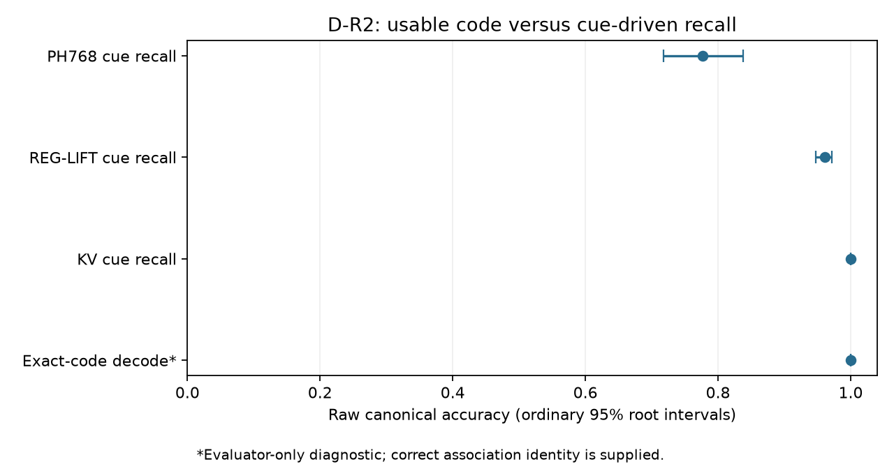

# Study D-R2: retrieval versus exact acquired-code decoding

November 19, 2026. Frozen [protocol](../docs/STUDY_D_R2_PROTOCOL.md), SOAM-090–093.

**Frozen classification: inconclusive.**
Exact-code minus ordinary PH768 accuracy: 0.22366, adjusted interval
[0.15357, 0.29018], width 0.13661.
Exact-code accuracy: 1.00000 [1.00000, 1.00000].
The practical gap is .05, precision width cap .10, exact-code adequacy floor .95.
Intervals use the frozen two-quantity Bonferroni family and ten independent roots.

| Output path | Raw accuracy | Canonical NMSE | Free-eight NMSE |
| --- | ---: | ---: | ---: |
| PH-FULL | 0.77634 | 0.08339 | 0.05813 |
| KV | 1.00000 | 0.00015 | 0.00015 |
| REG-LIFT | 0.96071 | 0.01767 | 0.01767 |
| Exact acquired-code decode (privileged) | 1.00000 | 0.01012 | Not a learner rollout |

All acquired snapshots of the correct object receive equal weight. The privileged
branch receives evaluator association identity; it is neither deployed recall nor
a target-selected best code. Ordinary predictions finish before diagnostic scoring.
No architecture, clamp, capacity, encoding or hyperparameter sweep was performed.
Inherited D-R1 development settings were fixed in advance; all data streams are fresh.
Ten roots contain 2,240 earlier-object query cues and 2,240 earlier-object acquired
snapshots. Each snapshot/cue is nested within its root; neither increases the number
of independent replicates. All-success intervals describe this finite sample only.

Every final sequence projector was audited: 40 projectors,
maximum stored-code residual 3.94e-14. Mean free-coordinate discrepancy to
the correct object's acquired codes is 0.00911;
to other objects' codes 0.05538.
Nonmonotone relationship-code fraction: 1.00000;
mean PH cycles 2.300, nonconvergence
0.00000. These are descriptive, with root intervals
in [statistics](study-d-r2/statistics.json). A bit mismatch need not imply a wrong
decoded relationship; convergence and span preservation do not prove useful recall.

Grounded one-step core NMSE averaged 8.749e-18;
free-eight core probe NMSE averaged 2.23e-16.
The common fitted action core remains an easy scaffold. Ordinary free rollouts begin
with retrieved features and never receive correct future observations.

Reproduction: 87 repeated arrays and 42 checkpoint tensors
match exactly. Independent reduction checks 210 reported root metrics,
all reconstructed acquired codes and stored spans. 110 historical D-R1
source hashes remain unchanged. All 12 planned fits complete;
failed attempts: 0. No exclusion, replacement or tuning.

Source commit `924acd8c3f32af9abfbd77ff69f8bab3030b01cb`; fingerprint `0df3abe0ec7906dea1d1978280709f99f3111b2c06fff066d759559ad3fba577`.
CPU float64, deterministic Torch, one intra-op/inter-op thread. Version/hardware,
all seeds and source hashes: [source](study-d-r2/source.json). Per-root configuration,
normalization and observations: [root results](study-d-r2/root-results.json).
Each arm shares 2,048 training transitions and 256 acquisition snapshots per root;
the prescribed repeated root is excluded from inference. Total fit attempts include
the fixture and repeat. Raw inputs, core/checkpoints, ordinary predictions and
diagnostic arrays remain in `runs/study-d-r2-v1/`.

Persistent storage, active/workspace state, batch recall/write timings and evaluator
storage are disclosed in [resources](study-d-r2/resources.json). PH uses a 768-square
float64 projector plus a transient effective weight matrix; each cycle executes
approximately 5*768^2 multiply-add pairs with the inherited invariant diagnostics.
REG-LIFT solves 256 visible-coordinate equations per query; KV scans eight keys.
These are implementation estimates, not optimized lower bounds or matched resources.
Exact-code tensors are evaluator-only and are counted separately from model memory.
The fresh ceiling is 900 CPU / 1,800 execution-wall seconds, 2 GiB RSS and 1 GiB
artifacts. [Feasibility](study-d-r2/feasibility.json) preceded confirmation; the final
ledger is `runs/study-d-r2-v1/ledger.json`.

This diagnostic can locate a gap between usable acquired codes and cue-driven
outputs, but cannot uniquely identify cue ambiguity, clamp interference, geometry,
mixed states or attraction basins as its cause. KV/REG-LIFT are descriptive references;
no new superiority, unknown-rejection, retention or sharing gate is tested. D-R1 and
all earlier negative results remain unchanged. The separate decision owns the next
recommendation; no follow-up is automatically activated.

## Closeout supplement

The separate [decision](STUDY_D_R2_DECISION.md) accepts valid, precision-qualified
inconclusive evidence and retains KV. The four numerical phases used 26.703657 CPU
seconds, 26.829175 execution-wall seconds and 366,903,296 B peak RSS;
[resource receipt](study-d-r2/resource-final.json). Archive packaging is reporting-only
and charged separately to the same fixed allocation. No extra inference or fit is run.
