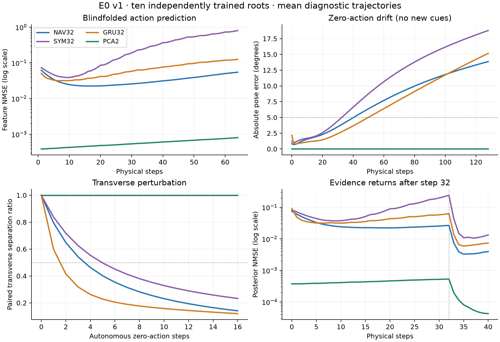

# Study E0 v1: action navigation and local recovery, with unresolved stationary drift

Date: 2026-11-21. SOAM-094–096. [Frozen protocol](../docs/STUDY_E0_PROTOCOL.md),
[manifest](../docs/protocols/study_e0_v1.json), [owner selection](../docs/requests/e0_2026_11_21.md),
[harness receipt](STUDY_E0_HARNESS.md), [machine-readable results](study-e0/summary.json).

**NAV32 passes six of seven frozen criteria; the joint result is inconclusive.**
Its 128-step zero-action pose error is 13.861° [12.119, 16.278], above the 5°
target. The adjusted interval's width is 4.159°, exceeding the frozen 4° cap, so
the protocol classifies this endpoint as imprecise rather than adequately precise
negative evidence. This is an unfavorable stationary result, not a nearly passing
pose estimate. No model passes the complete operational geometry claim.

All 58 scientific fits completed: 14 development, 40 confirmation and four exact
repeats, plus four engineering fixture fits. There are no failed fits, exclusions,
unavailable geometry measurements or confirmation-driven changes. Repetition matches
108 arrays and 29 checkpoint tensors exactly. Independent reduction checks 280 root
metrics and all 28 adjusted intervals.

**Terminology clarified November 22, 2026:** “Blindfolded action prediction” means actions
are supplied after the initial cue, but no new sensory observations arrive. “Zero-action
drift” means the action is zero and no new observations arrive. Blindfolded action NMSE (64
steps) averages sensory prediction error over 64 steps; the zero-action endpoint is absolute
pose error after 128 steps, in degrees, including initialization error. Archived keys
`free_nmse`, `free_horizon` and `stationary_deg` remain unchanged. Labels and figure titles
were clarified; measurements, criteria and decisions are unchanged.

## What was tested

One orientation, one population, offline learning, frozen evaluation parameters.
The sensory stream is the unchanged seed-1729 orthonormal projection of a unit
circle into twelve features, with partial/noisy cues. The sensor is rank two and
the physical action rule is simple; this is substantial supplied scaffolding.
True angle and inverse projection enter the evaluator only. The models learn from
clean sensory prediction targets, not hidden-state coordinates or angle labels.

NAV32 uses learned symmetric zero-action weights and learned skew action weights.
SYM32 replaces the skew action structure with symmetric weights. GRU32 has the
same 32-unit state and input/correction/readout interfaces. PCA2 learns its basis,
polynomial action map and filter statistics from the same training targets; its
rank, polynomial action features and exact zero-action stationarity are supplied.
These are not equal-prior or perfectly parameter-matched alternatives.

Each fit sees 19,200 training sequences, 480,000 distinct clean sensory snapshots,
and corrupted views of those same snapshots. Neural models make 600 optimizer
updates; PCA2 makes two deterministic passes over the same data. Its extra pass
is counted as repeated processing, not new observations. All model families have
identical training-data hashes within each confirmation root. There is no online
parameter update, persistent memory insertion, attention, inter-module message or
learned encoder comparison.

Learning rates {.001,.003} were the entire tuning domain. Two development roots
selected .003 for all neural families; [selection](study-e0/selection.json) was
committed before confirmation. Ten independently trained confirmation roots
201–210 use fresh streams and novel action magnitudes. Root 201 is repeated.

## Frozen results

Values below are means with simultaneous Bonferroni-adjusted bootstrap intervals
over the ten independent roots, covering seven endpoints × four models. Timesteps
and grid points are averaged within roots, never treated as independent replicates.
There are 20,000 resamples; all raw root values are in [CSV](study-e0/root_metrics.csv).

| Endpoint | NAV32 | GRU32 | SYM32 | PCA2 |
| --- | --- | --- | --- | --- |
| Blindfolded action NMSE (64 steps); upper ≤ .05 | .03336 [.02891, .03869] | .06778 [.06106, .07446] | .29979 [.25114, .35166] | .000568 [.000499, .000651] |
| Grounded one-step NMSE; upper ≤ .05 | .00917 [.00554, .01437] | .00744 [.00622, .00909] | .03219 [.02799, .03676] | .0000479 [.0000384, .0000649] |
| Zero-action drift at 128 (absolute pose error); upper ≤ 5° | 13.861 [12.119, 16.278] | 15.163 [12.241, 18.296] | 18.790 [15.590, 22.650] | .00000162 [.00000149, .00000176] |
| Transverse separation ratio at 16; upper ≤ .5 | .1412 [.1083, .1687] | .1201 [.1094, .1342] | .2328 [.2061, .2616] | 1.000 [1.000, 1.000] |
| Perturbation-induced pose error; upper ≤ 3° | .2183 [.1948, .2433] | .9806 [.8890, 1.0872] | .9412 [.7988, 1.0587] | .00000751 [.00000673, .00000840] |
| Tangent retention; interval within [.8,1.2] | .9880 [.9790, .9955] | .9995 [.9976, 1.0016] | .9922 [.9832, 1.0020] | 1.000 [1.000, 1.000] |
| Final returning-cue NMSE; upper ≤ .05 | .003950 [.003552, .004303] | .007333 [.006189, .009157] | .013321 [.011305, .015318] | .0000425 [.0000367, .0000520] |

Precision caps are .04 NMSE, 4° zero-action drift, .4 transverse/tangent ratio,
and 3° perturbation-induced pose error. Applying them without retrospective changes:

- **NAV32: inconclusive.** Six passes; zero-action interval width 4.159° exceeds 4°.
- **GRU32: negative configured-model evidence.** Blindfolded action NMSE (64 steps) precisely exceeds
  .05. Zero-action drift is also unfavorable but imprecise; five other criteria pass.
- **SYM32: inconclusive.** Blindfolded action error and zero-action drift are unfavorable but too
  imprecise under their caps; five criteria pass.
- **PCA2: negative for the joint local-attraction claim.** Transverse ratio is
  exactly one: it preserves a displaced state instead of autonomously recovering.
  It passes the other six criteria and is the strongest accuracy/resource reference
  for this scaffold. Its geometry result is not a failure of its filtering purpose.

The adjusted interval is wholly above the stationary target for every neural
family. Calling NAV32/SYM32 inconclusive preserves the preregistered precision rule;
it does not erase the observed drift. Boundary-valued PCA intervals reflect this
fitted model's supplied zero-action identity, not population-wide certainty.

## Diagnostic trajectories and limits



Lines show means across ten roots; they are descriptive, without simultaneous
confidence bands. The table supplies the inferential intervals. Cue return begins
at step 33, following 32 missing observations.

NAV32's mean zero-action pose error rises from .818° at initialization to 2.743°
at step 24, 8.194° at step 64 and 13.861° at step 128. All ten root means at 128
are above 11°, with a range of 11.167°–18.903°. Final displacement relative to its
own initialized decoded pose averages 13.813°. This is accumulated autonomous
drift, not merely an inaccurate initial cue. The short training horizon (24) is
a plausible contributor, not an established unique cause.

NAV32's mean blindfolded action NMSE is .03301 on the interpolation-only stream and
.03402 on the extrapolation-only stream. Constant positive/negative action streams
score .03786/.04023. For GRU32, interpolation/extrapolation score .02900/.17373;
for SYM32, .09602/.72686. These are descriptive fresh-stream diagnostics; they do
not authorize a second tuning pass or imply universal architectural superiority.
The [summary](study-e0/summary.json) also preserves paired descriptive prediction
differences against every required control.

All three neural models show local transverse contraction. It is therefore not
unique evidence for a Hopfield-inspired core. The contraction measure compares
perturbed and unperturbed trajectories perpendicular to the sampled endpoint
family; both trajectories may drift. It neither estimates basin volume nor proves
convergence to a fixed invariant manifold. The normal perturbation is only 10% of
the family radius; larger disturbances and other directions are untested.
The tangent measure is an average finite-separation proxy; it does not establish
local injectivity or preserve every individual pose indefinitely. The failed joint
stationarity requirement prevents those short-horizon proxies from passing the
broader operational claim.

PCA2 accurately predicts and holds still with no transverse restoration. This
separates useful state estimation from an attracting recurrent representation.
Fixed trigonometric features, a known two-dimensional baseline rank, supervised
clean sensory targets and a tiny tuning domain sharply limit generalization to
natural input, sparse coding, storage capacity or learned reference frames. These
results do not resolve historical H1/H6, shared-neuron, acquisition or handover gates.

## Resources, provenance and reproducibility

| Model | Persistent scalars | Persistent bytes | Active state floats | Prediction MAC proxy |
| --- | ---: | ---: | ---: | ---: |
| NAV32 | 4,044 | 16,176 | 32 | 2,048 |
| SYM32 | 4,044 | 16,176 | 32 | 2,048 |
| GRU32 | 5,324 | 21,296 | 32 | 3,168 |
| PCA2 | 52 | 208 | 6 (two means + four covariance entries) | 36 |

Counts include learned initializers, readouts and correction layers. NAV32/SYM32
allocate full matrices with redundant symmetry coordinates; their effective core
matrix degrees of freedom are 1,024/1,056. Each model additionally uses one prior
workspace of its state size. The common fixed sensory projection is 24 float32
values (96 bytes), outside the fitted model. Training optimizer state, task data,
evaluator grids and archived diagnostic trajectories are not persistent neural
memory; they are included in observed process RSS/artifact use. There are no stored
training exemplars, cloned populations or external retrieval store at inference.

MAC proxies exclude nonlinearities, elementwise operations, symmetrization and
small matrix inverses. The mean CPU for the full evaluation battery is .0726 s
NAV32, .0726 s SYM32, .0779 s GRU32 and .0891 s PCA2; these include diagnostic work
and are not a production inference-latency benchmark. Low-dimensional filtering
uses fewer scalars but small Torch matrix solves have overhead.

The entire numerical inventory consumes **150.928 CPU / 151.145 execution-wall
seconds**, with peak RSS 336,904,192 bytes and raw artifacts 155,163,746 bytes.
Two independent audit/figure passes add 2.035 CPU / 2.041 wall seconds and peak at
289,882,112 bytes; the second follows report-script formatting and preserves the
first pass source/receipt history. Neither pass performs fitting. Both together remain far below the frozen 3,600 CPU / 7,200 wall,
2 GiB RSS / 1 GiB artifact ceilings. Software-validation time is reported separately,
not as experimental fitting. No budget extension or failed-fit retry occurred.

The [receipt](study-e0/receipt.json) records exact versions, platform, dtype,
threading, deterministic settings, source/manifest/protocol hashes, seeds and
resource readings. Numerical source fingerprint:
`4dd66fc4194336388dc8a96a742d157eab7eceac521112760f385744d5b21622`.
Harness commit `7168e2e`; development began at `7b07dd4`; settings froze and
confirmation began at `95e7fd0`. Models use CPU float32; PCA/ridge and statistical
reductions use float64. The fixed initial projection is unchanged.

All 148 source-file hashes match the working source and frozen archive. All 124
checkpoint/array hashes match; the [complete archive inventory](study-e0/archive_sha256.json)
also fingerprints records, sources and the ledger. The local full archive is
`runs/study-e0-v1` (ignored by Git); summaries, raw root table, receipts, figures and
payload hashes are committed. This is not a claim that the 155 MB archive was
uploaded or published. The [independent reducer](study-e0/analysis.py) checks raw
geometry from saved states/readouts, root aggregates and bootstrap intervals,
and creates the figure; it performs no new fitting.

Reproduction from the frozen source uses a fresh output directory, in this order:

```text
uv run python -m soam.navigation.runner fixture --output runs/e0-reproduction
uv run python -m soam.navigation.runner development --output runs/e0-reproduction
uv run python -m soam.navigation.runner confirmation --output runs/e0-reproduction
```

A reproduction is a new recorded execution, not unused allocation from this run.
The original runner preserves completed attempts, rejects changed source/selection,
checks ceilings during execution and never retries a failed fit automatically.

Validation: 328 tests before changes; the final full suite passes 339 tests in
17.84 seconds; 11 focused E0 tests also passed after archival changes. Ruff passes
for the harness, tests and independent reducer; 98 tickets/two templates validate
and all 536 checked local Markdown links resolve.
The figure was visually inspected. The [scoped decision](STUDY_E0_DECISION.md)
interprets these measurements and leaves later experiments conditional.
