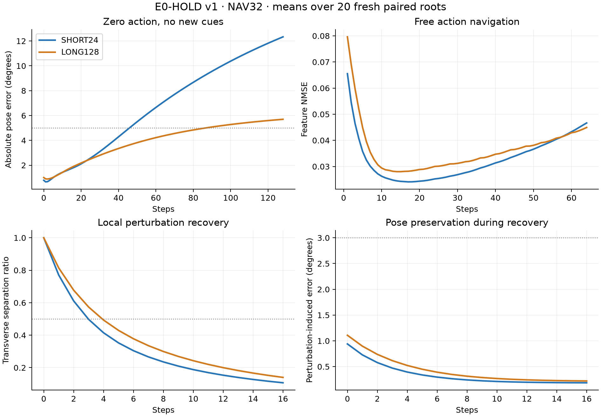

# E0-HOLD v1: longer stationary training reduces drift but does not pass the joint fix

2026-11-21 · SOAM-098–100 · [Protocol](../docs/STUDY_E0_HOLD_PROTOCOL.md) ·
[Manifest](../docs/protocols/study_e0_hold_v1.json) · [Full tables](study-e0-hold/tables.md) ·
[Receipt](study-e0-hold/receipt.json) · [Decision](STUDY_E0_HOLD_DECISION.md).

**Longer stationary training reduced NAV32's mean 128-step pose error from 12.332°
to 5.698°, about 54%, but did not meet the declared “fix without harm” criterion.**
The remaining error is precisely above the five-degree target. Action prediction
passes its prespecified degradation margin, while transverse-recovery noninferiority
remains unresolved. Formal outcome: **negative for the declared joint fix**.
This is useful improvement, not a failed execution or a general rejection of the
mechanism. Historical E0 remains inconclusive under its original experiment.

## Intervention and evidence

Twenty fresh paired roots compare SHORT24 and LONG128 for NAV32, SYM32 and GRU32,
with PCA2 as a conventional reference. Both neural arms start from identical
parameters and receive identical 24-step prefixes, actions, masks and observations.
LONG128 extends only entirely stationary episodes to 128 steps, with no further
cues. Its tail reuses the already supplied stationary sensory target. Episode
losses have equal total weight, so longer episodes do not multiply stationary
examples' weight relative to moving examples. The changed temporal average and
longer backpropagation are both part of this intervention.

All models use the unchanged fixed sensory projection and E0 inference/evaluation
code. Training has 600 updates at the previously selected .003 learning rate;
there is no new tuning, restart or checkpoint selection. The long arm was not
separately optimized. The conclusion concerns this fixed training recipe, not the
best achievable result under each horizon.

All **147 scientific fits** completed: 140 confirmation fits and seven exact
repeats, plus seven fixture fits. There are no failed fits, excluded roots or
unavailable geometry results. Repetition matches **189 arrays and 54 tensors**
exactly. Sixty main neural pairs and three repeated pairs have identical initial
parameter hashes, and every model/arm shares the prefix-data hash within a root.
The independent audit verifies 980 root metrics and all 13 adjusted intervals.

## Confirmatory NAV32 result

The following intervals are simultaneous bootstrap intervals across the frozen
13-quantity NAV32 family, using 20 independent paired roots and 20,000 resamples.
Timesteps and grid points are averaged within roots, not counted as independent
replicates. All widths and thresholds were frozen before fitting.

| Quantity | Mean [adjusted interval] | Frozen requirement | Result |
| --- | --- | --- | --- |
| Stationary improvement, SHORT minus LONG | 6.635° [5.017, 8.805] | lower ≥ 5°, width ≤ 4° | Pass |
| LONG stationary error at 128 | 5.698° [5.259, 6.183] | upper ≤ 5°, width ≤ 4° | Precise failure |
| LONG free-64 NMSE | .03651 [.03252, .04044] | upper ≤ .05 | Pass |
| Free-64 degradation, LONG minus SHORT | +.003606 [−.001027, .006732] | upper ≤ .01 | Pass |
| LONG transverse ratio at 16 | .13996 [.11373, .16365] | upper ≤ .5 | Pass |
| Transverse-ratio degradation | +.03312 [.00731, .06218] | upper ≤ .05 | Unresolved |

Eleven of thirteen criteria pass. The stationary-error interval is only .923° wide,
well inside its four-degree precision cap, and wholly above the five-degree target.
This is adequately precise negative evidence for the declared fix, unlike E0's
wide stationary interval. The earlier result is not reclassified.

Transverse recovery remains useful in absolute terms, but is weaker in the paired
comparison: the ratio rises from .10684 to .13996 (lower is better). Its adjusted
degradation interval is entirely positive and crosses the +.05 practical limit.
Thus the study establishes neither noninferiority within that margin nor a
degradation definitively beyond it. It is not an equivalence result.

Grounded prediction, returning-cue correction, perturbation-induced pose error,
tangent retention and the remaining paired guards pass. Some small degradations
are measured: returning-cue NMSE rises by .001283 and induced pose error by .0351°,
both below their allowed margins. “Without harm” meant the frozen noninferiority
margins, not unchanged measurements. The complete thirteen-criterion table,
interval widths, paired differences and [raw root values](study-e0-hold/root_metrics.csv)
are retained.



These are descriptive mean trajectories, not confidence bands. The mixed-action
primary average passes its degradation guard, but this does not establish unchanged
accuracy for every action sequence. In the descriptive constant positive/negative
rotation streams, NAV32 NMSE rises from .03844/.03643 to .05352/.05223. The full
interpolation/extrapolation and direction diagnostics are in the tables.

## Required controls

These are descriptive means; their 95% intervals and paired differences are in
the [full tables](study-e0-hold/tables.md). They do not replace the NAV32 primary
claim and were not treated as confirmatory discoveries.

| Model | Stationary error SHORT → LONG | Free-64 NMSE SHORT → LONG | Transverse ratio SHORT → LONG |
| --- | --- | --- | --- |
| NAV32 | 12.332° → 5.698° | .03290 → .03651 | .10684 → .13996 |
| SYM32 | 17.085° → 5.388° | .32763 → .35428 | .22372 → .21948 |
| GRU32 | 12.975° → 2.631° | .07717 → .26582 | .12052 → .11924 |
| PCA2, one reference | .00000167° | .0005688 | 1.000 |

The GRU's stronger stationary accuracy accompanies markedly worse action
prediction in this fixed recipe. Stationary retention alone would have selected
a misleading result. The symmetric control improves stationary error but retains
poor free action prediction. PCA2 remains the strongest prediction/state-size
reference for this scaffold; its supplied zero-action identity provides no
autonomous transverse restoration. None of these observations establishes a
universal Hopfield advantage or a necessary stability/navigation tradeoff.

## Cost, provenance and limitations

Each neural fit uses 19,200 original episodes, 480,000 distinct original sensory
snapshots and 600 optimizer updates. LONG128 adds an average **501,248.8 stationary
transition evaluations and repeated target comparisons per root**, with zero new
observations. NAV32 fit CPU rises from 2.901 to 9.626 seconds, about 3.32×. This is
not a compute-matched comparison. The other neural families show similar extra
cost; PCA2 uses two passes over the prefix data. Counts and learning traces remain
in every fit record and the resource table.

Parameter/state counts are unchanged: NAV32/SYM32 have 4,044 persistent scalars
and 32 active-state floats; GRU32 has 5,324/32; PCA2 has 52/6, including covariance.
Readouts, initializers and correction layers are included. Each model uses a prior
workspace of its state size. The shared fixed projection is another 24 float32
values (96 bytes). Evaluation timing includes diagnostic work and is not a
production latency benchmark. The raw archive, optimizer workspace, task data and
diagnostic trajectories are counted in RSS/artifacts, not as persistent model memory.

Recorded numerical use is **826.872 CPU / 827.135 execution-wall seconds**, plus
2.024 CPU / 2.026 wall seconds for independent audit, tables and figures. Peak RSS
is 354,746,368 bytes; raw artifacts total 544,009,667 bytes. All frozen 7,200 CPU /
14,400 wall, 2 GiB RSS and 2 GiB artifact ceilings pass without extension or retry.
Software validation is reported separately from scientific fitting.

Harness source commit: `6733775`. Confirmation source commit: `cff19dd`.
Source fingerprint:
`6501d4de87f6fd9c7b352c6142eb98ccc4353a813bd46fa5052eafec05a8c307`.
The [receipt](study-e0-hold/receipt.json) contains full configuration identity,
software/numerics, source hashes and the audit record. Execution uses deterministic
single-thread CPU Torch, float32 recurrent models and float64 fitted/statistical
reductions. Both original and remapped stream roots are recorded per fit.

All 153 current source hashes match the archived and working source; all 148
historical E0 source hashes remain unchanged. All 308 checkpoint/array hashes
match. [Checksums](study-e0-hold/archive_sha256.json) cover 621 raw archive files.
[Completion-record file timestamps](study-e0-hold/trial_record_times.json) are
explicitly filesystem completion times, not invented fit-start times. The full
archive remains local at `runs/study-e0-hold-v1`, ignored by Git. Summaries, root
metrics, figures, receipts, [analysis code](study-e0-hold/analysis.py) and hashes
are committed; no raw archive upload or publication is claimed.

The rank-two synthetic sensor, supplied stationary targets, fixed learning recipe,
twenty roots and finite horizons sharply limit generalization. The recovery metric
is a paired local transverse proxy relative to a sampled state family; it is not
basin volume or proof of a continuous invariant manifold. Mean tangent retention
does not prove every pose remains distinguishable indefinitely. No module coupling,
hierarchy, capacity improvement, acquisition, control or neuroscience claim follows.

Validation: 339 pre-change tests; **348 final-source tests passed** in 28.60 seconds;
nine new invariant tests; Ruff and ticket checks passed. The figure was inspected.
Reproduction from the frozen source uses a fresh output directory:

```text
UV_CACHE_DIR=/private/tmp/soam-uv-cache uv run --offline --no-sync python -m soam.hold.runner fixture --output runs/e0-hold-reproduction
UV_CACHE_DIR=/private/tmp/soam-uv-cache uv run --offline --no-sync python -m soam.hold.runner confirmation --output runs/e0-hold-reproduction
```

Reproduction is a new recorded execution, not an extension of this completed run.
The [decision](STUDY_E0_HOLD_DECISION.md) preserves this result and leaves any
further optimization or module work conditional.
