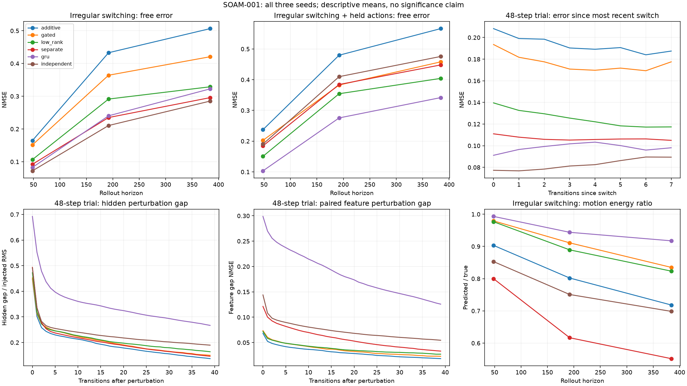

# SOAM-001: stronger substrate controls — October 25, 2026

**The stronger screen passes 17 of 18 model/seed trials.** Additive seed 23 fails
irregular-switch accuracy: NMSE **0.2527**, against the preregistered **0.25** limit.
All three seeds pass for gated, low-rank, separate-core, GRU, and fully independent
predictors. This completes the controlled comparison, including its negative result;
it does not complete Gate 1 or establish shared structure, attractors, or self-organization.

All six seed-11 repeats exactly match numerical metrics, learned parameters, and
saved trajectories. Timing fields are excluded from equality checks. No tuning,
checkpoint selection, threshold changes, or selective seed retries occurred.

## Protocol and provenance

The [protocol](../docs/SUBSTRATE_CONTROLS.md) and implementation were committed before
measured runs as `7238e6ce69ce5a4e561960b290a2222e5e16aeb5`. Both original and repeat
runs started with a clean working tree. Source SHA-256:
`6c0ae5c4344472957ab472298751be9348de55863012ae9f8ce2045df20af269`.

- [Resolved configuration](substrate-controls/config.json), [source/runtime provenance](substrate-controls/provenance.json),
  [repeat provenance](substrate-controls/repeat-provenance.json), and [reproduction checks](substrate-controls/reproducibility.json).
- Python 3.12.13, PyTorch 2.14.1, NumPy 2.5.4; macOS ARM64, float32 CPU, one thread,
  deterministic algorithms. Dependencies remain pinned by `uv.lock`.
- Six variants × seeds 11, 23, 47 = 18/18 completed trials, plus 6/6 seed-11 repeats;
  zero execution failures. Trial timestamps/statuses: [original](substrate-controls/trials.json)
  and [repeat](substrate-controls/repeat-trials.json).
- Every trial used 600 Adam steps, 48 sequences per step, 24 transitions per sequence:
  28,800 sequences / **691,200 training transitions**. Training data order/exposure
  is paired across models. New stream namespace 1 separates these data from the
  original baseline; development and test streams remain separate. No tuning was done.
- Evaluation uses 96 sequences (32 per starting context) per split, horizon, and
  condition. Horizons are 48, 192, and 384. Conditions are steady, regular switching,
  irregular switching, and irregular switching with actions held for four steps.
  Irregular dwell times and non-cyclic successor contexts are absent from training.
  Horizons use distinct streams, not prefixes of the same trajectories.

The original [baseline report](BASELINE.md), configuration, and artifacts remain
historical evidence. Different data streams mean this study is not a paired estimate
of improvement over that earlier run.

## Budget-matched comparison

Mean ± sample SD across three seeds; NMSE divides prediction MSE by target feature
energy. These are descriptive comparisons, not statistical significance claims.
All trainable parameters are counted, including initializer, readout, and context
machinery. Widths were chosen analytically before training, with a 5% tolerance.

| Model | Width | Parameters | Difference from reference | Grounded 48 | Steady free 48 | Irregular free 48 | Held-action free 48 | Irregular free 384 | Screen |
| --- | ---: | ---: | ---: | ---: | ---: | ---: | ---: | ---: | ---: |
| Additive | 40 | 2,892 | 0.00% | .0084 ± .0017 | .0724 ± .0257 | .1647 ± .0855 | .2374 ± .1376 | .5065 ± .2100 | 2/3 |
| Gated | 39 | 2,898 | +0.21% | .0089 ± .0020 | .0704 ± .0361 | .1514 ± .0862 | .2027 ± .1019 | .4207 ± .1575 | 3/3 |
| Low-rank | 37 | 2,873 | −0.66% | .0076 ± .0008 | .0448 ± .0028 | .1065 ± .0293 | .1506 ± .0476 | .3289 ± .1215 | 3/3 |
| Separate cores | 25 | 2,812 | −2.77% | .0045 ± .0007 | .0856 ± .0158 | .0922 ± .0070 | .1845 ± .0123 | .2958 ± .0206 | 3/3 |
| GRU | 24 | 2,916 | +0.83% | .0017 ± .0004 | .0438 ± .0261 | .0825 ± .0751 | .1033 ± .0818 | .3225 ± .2125 | 3/3 |
| Independent | 20 | 2,976 | +2.90% | .0047 ± .0004 | .0788 ± .0088 | .0722 ± .0141 | .1905 ± .0197 | .2852 ± .0131 | 3/3 |

Grounded 48 refers to one-step predictions with sensory correction throughout a
48-transition steady sequence. All other accuracy columns are free rollouts with
only the initial observation. The held-action condition also uses irregular switching.

The fully independent model has disjoint sensory initializers, transition weights,
and readouts. At a switch it reinitializes the new active predictor from the previous
**predicted sensory feature**, without receiving a real future observation. This
is a different switching mechanism from the shared models' continuous hidden-state
carry. Training differentiates through that handoff, so parameter independence does
not imply isolated optimization. The historical separate-core control still shares
its sensory initializer/readout. These distinctions limit architectural conclusions.

The independent control has the lowest mean irregular-switch error; GRU has the
lowest mean held-action error. Low-rank improves on additive descriptively, but
three seeds in one synthetic family do not establish a general advantage. Equal
parameter counts also do not equalize optimization, state dimension, or compute.

## Switching, stability, and perturbation findings

The regular-to-irregular change raises mean 48-step free NMSE from .0666 to .1647
for additive, .0439 to .1065 for low-rank, and .0173 to .0825 for GRU. Familiar
switch schedules therefore substantially understated the challenge. The additive
failure is retained exactly, even though it is close to the threshold.

All unperturbed extended trajectories are finite and below the 1.5 hidden bound;
the maximum magnitude is .9995. No condition has aggregate motion energy below the
registered collapse diagnostic of .25. These properties do not imply correct
long-term dynamics: irregular 384-step mean NMSE ranges from .2852 to .5065.
Structural tanh/GRU bounds are not evidence of useful attractors. Aggregate motion
can also hide individual trajectory problems.

Perturbations shrink relative to paired unperturbed model trajectories, but increase
error against reality on average. In 48-step irregular trials:

| Model | Final hidden gap / injected RMS | Excess feature MSE after perturbation |
| --- | ---: | ---: |
| Additive | .1370 | +.000906 |
| Gated | .1501 | +.000866 |
| Low-rank | .1640 | +.001113 |
| Separate cores | .1464 | +.001493 |
| GRU | .2669 | +.004562 |
| Independent | .1897 | +.001538 |

The GRU's lower mean unperturbed error comes with greater perturbation sensitivity
in this comparison. Independent-model handoffs change hidden coordinates, so paired
feature gaps and errors against reality are more comparable than hidden gaps alone.
Equal per-unit perturbation standard deviations do not equalize functional perturbation
size across models/readouts.

Switch-lag curves use the most recent switch and include sample counts in the data;
a later switch censors the earlier switch's window. Curves do not by themselves
measure a causal recovery time, because contexts, states, and sample counts vary
with lag. Per-start and per-active-context errors, all horizons/conditions, stability,
motion energy, and perturbation measurements are retained in the
[compact results](substrate-controls/results.json).

## Resources and artifacts

Training averages 3.49, 4.45, 4.74, 5.59, 4.03, and 9.55 seconds respectively in table
order. Linear recurrent-step/readout MAC estimates are 2,200, 2,106, 2,220, 1,000,
2,448, and 700. Independent predictors incur an extra `12 × hidden_width` initializer
MACs per switch; condition-specific totals are reported. MAC estimates exclude
nonlinearities, assimilation, backward computation, and dispatch. Runtime includes
training costs omitted by the estimates; independent Python dispatch/handoffs are
especially relevant. Full byte and timing tables are in the
[generated summary](substrate-controls/summary.md).

The original grid took 171.05 seconds and repeats 57.09 seconds, excluding process
startup and report generation. Raw local runs occupy **1,371,446,341 bytes (1.37 GB)**,
exceeding the initial 1 GB storage estimate because all test hidden trajectories and
curves were retained. This changes the resource estimate, not the scientific design.
Runtime remained below the 20-minute budget. No cloud computation was used.

Full immutable local runs: `runs/substrate-controls-v1/` and
`runs/substrate-controls-v1-repeat/` (Git-ignored), including checkpoints, training
logs, full metrics, and all test trajectory arrays. Tracked records keep every scalar
metric and switch-lag record while omitting long curve arrays. The
[artifact index](substrate-controls/artifact-index.json) records omitted fields, full
and compact result hashes, and the report script fingerprint. This compact archival
step was added after the measured runs; it does not alter their source identity or
numerical records. Figures use the full results. The extended summary and independent
seed-11 diagnostic were visually inspected. All example figures use predetermined
seed 11, not the best-performing seed.

## Verification and consequences

- Before changes: **15 tests passed**. After implementation: **27 tests passed**, covering
  matched counts, no-write/no-future-observation inference, disjoint independent weights,
  manual handoffs, gradients, reserved streams, held actions, censored switch windows,
  and end-to-end exact reproduction. Ruff and ticket validation passed.
- All six variants completed a two-step smoke run before measured trials. Smoke output
  is in `runs/substrate-controls-smoke-v1`; it is not scientific evidence.
- Commands: `uv run pytest`; `uv run ruff check soam tests scripts`;
  `uv run python scripts/check_tickets.py`; the original/repeat/reproduction commands
  in the [protocol](../docs/SUBSTRATE_CONTROLS.md); and
  `uv run python scripts/report_controls.py runs/substrate-controls-v1 reports/substrate-controls`.
  Writable `UV_CACHE_DIR` and `MPLCONFIGDIR` overrides were used for sandbox caches.
- The local worker extracted the existing reproduction invariants; those were checked
  against the script. The primary agent designed, implemented, ran, and interpreted
  the experiment. No worker controlled trials or selected parameters.

SOAM-001 is complete with a mixed result. **SOAM-002 is now eligible for Gate 1 review.**
That decision must choose a reference checkpoint and plastic parameter family, and
state whether long-horizon drift and perturbation sensitivity are acceptable for a
bounded local-writing study. It should not automatically retain the additive
reference merely because the original easier screen passed. No local writing has
been implemented and no gate outcome is recorded here.

Still untested: reuse of shared transformations, withheld-context transfer, composition,
context inference, partial observations, and continual acquisition/retention. All models
were trained on all three known regimes. Good prediction in this experiment cannot
establish those stronger SOAM claims.
