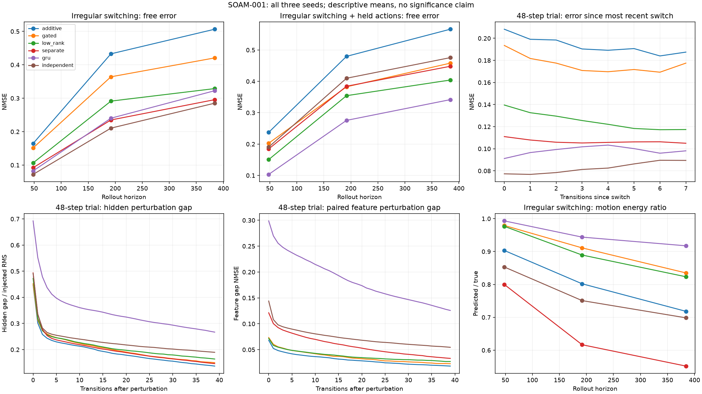

# Substrate controls: measured summary

Source commit: `7238e6ce69ce5a4e561960b290a2222e5e16aeb5`. Source SHA-256: `6c0ae5c4344472957ab472298751be9348de55863012ae9f8ce2045df20af269`.
Completed 18/18 planned trials; seeds [11, 23, 47].
Mean ± sample SD across seeds. NMSE is error divided by target feature energy.

| Model | Width | Params | Difference | Grounded 48 | Steady 48 | Irregular 48 | Held-action 48 | Irregular 384 | Screen |
| --- | ---: | ---: | ---: | ---: | ---: | ---: | ---: | ---: | ---: |
| additive | 40 | 2892 | +0.00% | 0.0084 ± 0.0017 | 0.0724 ± 0.0257 | 0.1647 ± 0.0855 | 0.2374 ± 0.1376 | 0.5065 ± 0.2100 | 2/3 |
| gated | 39 | 2898 | +0.21% | 0.0089 ± 0.0020 | 0.0704 ± 0.0361 | 0.1514 ± 0.0862 | 0.2027 ± 0.1019 | 0.4207 ± 0.1575 | 3/3 |
| low_rank | 37 | 2873 | -0.66% | 0.0076 ± 0.0008 | 0.0448 ± 0.0028 | 0.1065 ± 0.0293 | 0.1506 ± 0.0476 | 0.3289 ± 0.1215 | 3/3 |
| separate | 25 | 2812 | -2.77% | 0.0045 ± 0.0007 | 0.0856 ± 0.0158 | 0.0922 ± 0.0070 | 0.1845 ± 0.0123 | 0.2958 ± 0.0206 | 3/3 |
| gru | 24 | 2916 | +0.83% | 0.0017 ± 0.0004 | 0.0438 ± 0.0261 | 0.0825 ± 0.0751 | 0.1033 ± 0.0818 | 0.3225 ± 0.2125 | 3/3 |
| independent | 20 | 2976 | +2.90% | 0.0047 ± 0.0004 | 0.0788 ± 0.0088 | 0.0722 ± 0.0141 | 0.1905 ± 0.0197 | 0.2852 ± 0.0131 | 3/3 |

| Model | Weight bytes | Optimizer bytes | Stored eval tensor bytes | MACs/step | Train seconds |
| --- | ---: | ---: | ---: | ---: | ---: |
| additive | 11568 | 23168 | 67908096 | 2200 | 3.49 |
| gated | 11592 | 23220 | 66907392 | 2106 | 4.45 |
| low_rank | 11492 | 23028 | 64905984 | 2220 | 4.74 |
| separate | 11248 | 22536 | 52897536 | 1000 | 5.59 |
| gru | 11664 | 23360 | 51896832 | 2448 | 4.03 |
| independent | 11904 | 23880 | 47894016 | 700 | 9.55 |

Linear MACs exclude backward/assimilation/nonlinearity/dispatch and switch handoffs.
Per-condition switch counts and extra independent initializer MACs are in results.json.
Tensor storage counts are not peak process memory.

## Failed screen checks

- additive seed 23: irregular_accuracy

